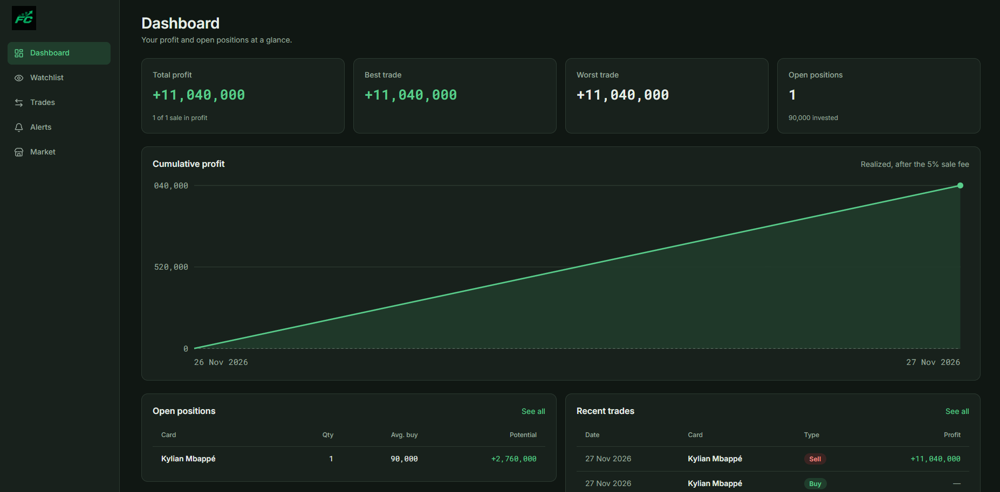
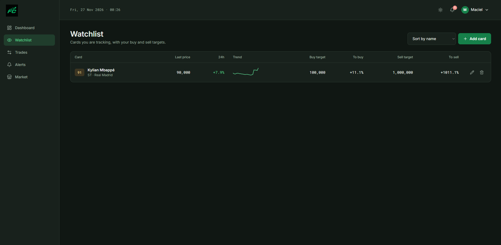
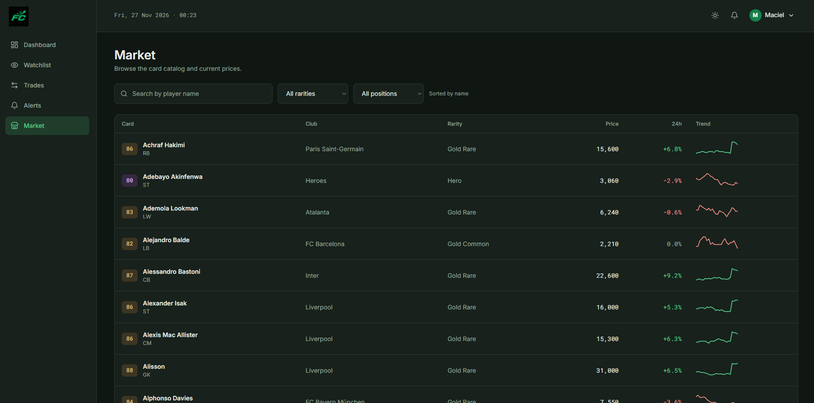

# FC Trade Manager — Frontend

**English** | [Português (BR)](README.pt-BR.md)


[](https://github.com/fc-trade-manager/frontend/actions/workflows/ci.yml)

React 19 + TypeScript + Vite client for the [FC Trade Manager API](https://github.com/fc-trade-manager/backend). It lets you browse the card market, keep a watchlist with buy and sell targets, register your trades with the profit calculated **after the 5% market fee**, follow your results on a dashboard and read the alerts the API creates when a price reaches a target.

> **Unofficial fan project.** It is not affiliated with, endorsed by or connected to Electronic Arts. The cards and all prices are fictional demo data.

---

## Table of contents

- [Features](#features)
- [Screenshots](#screenshots)
- [Stack](#stack)
- [Getting started](#getting-started)
- [Routes](#routes)
- [How it talks to the API](#how-it-talks-to-the-api)
- [Notes on the data model](#notes-on-the-data-model)
- [Project structure](#project-structure)
- [Tests and CI](#tests-and-ci)
- [Test IDs (`data-testid`)](#test-ids-data-testid)
- [Known limitations](#known-limitations)
- [Credits](#credits)

---

## Features

| Page | What it does |
| --- | --- |
| Market (public) | Card catalog with search by name, rarity and position filters, pagination, current price, 24h change and a 30-day trend |
| Login / Register | Account creation (e-mail, username, display name, password) and sign-in, with a "keep me signed in" option |
| Dashboard | Total profit, best and worst trade, open positions with the potential value, recent trades and a cumulative profit chart |
| Watchlist | Cards with buy and sell targets, last price, 24h change and how far the price is from each target; add, edit targets, remove and sort |
| Trades | Register, edit and delete buys and sells; tabs for completed, open and all trades; profit and return per sale |
| Alerts | Feed of the alerts created by the API, all or unread only, mark one or all as read; a bell with the unread count in the header |
| Theme | Light and dark theme, remembered in the browser |

## Screenshots





## Stack

| Area | Technology |
| --- | --- |
| UI | React 19, TypeScript, [lucide-react](https://lucide.dev) icons |
| Build | Vite 8 |
| Routing | react-router-dom 7 |
| State and data | React hooks (`useAsync`, `usePrices`, ...) and `fetch`; no state or data-fetching library |
| Charts | Small SVG components written for this project (profit chart and sparklines), no chart library |
| Styling | Plain CSS with design tokens (`src/styles`), fonts Inter and Roboto Mono via Fontsource |
| Tests | Vitest + jsdom + Testing Library |
| Lint | oxlint |

## Getting started

### Prerequisites

- [Node.js](https://nodejs.org) 22 or newer (the CI uses 22)
- The [backend](https://github.com/fc-trade-manager/backend) running (by default on `http://localhost:5041`)

### Run

```bash
git clone https://github.com/fc-trade-manager/frontend.git
cd frontend
cp .env.example .env   # Windows (CMD): copy .env.example .env
npm ci
npm run dev
```

The app opens on `http://localhost:5173` (the port is fixed, and it is already allowed by the backend's CORS in Development).

### Configuration

| Variable | Default | Notes |
| --- | --- | --- |
| `VITE_API_URL` | `http://localhost:5041` | Base URL of the API, without a trailing slash. Restart `npm run dev` after changing it. In production, add the front-end origin to the backend's `Cors:AllowedOrigins`. |

### Scripts

| Command | What it does |
| --- | --- |
| `npm run dev` | Development server |
| `npm run build` | Type-checks (`tsc -b`) and builds to `dist/` |
| `npm run preview` | Serves the build locally |
| `npm run lint` | oxlint |
| `npm test` | Unit tests once (`vitest run`) |
| `npm run test:watch` | Unit tests in watch mode |

## Routes

| Route | Access | Page |
| --- | --- | --- |
| `/market` | Public | Market |
| `/login`, `/register` | Only when signed out | Sign in, create account |
| `/` | Signed in | Dashboard |
| `/watchlist` | Signed in | Watchlist |
| `/trades` | Signed in | Trades |
| `/alerts` | Signed in | Alerts |

Any other path goes to `/`.

## How it talks to the API

- **One module for HTTP** (`src/lib/api.ts`): every call goes through a single `request` function that adds the token, reads the JSON and turns failures into an `ApiError` with the status and the API's message.
- **Session**: after login the API returns an access token (short-lived) and a refresh token. With "keep me signed in" the session is kept in `localStorage`, otherwise in `sessionStorage`. Logging out revokes the refresh token on the server.
- **Silent refresh**: when a request fails with `401`, the front exchanges the refresh token for a new pair and repeats the request once. Several requests failing at the same time share a **single** refresh call (the API rotates the refresh token, so two parallel refreshes would invalidate each other).
- **Prices require login**: `GET /api/cards/{id}/prices` is authenticated in the backend, while the catalog is public. For a visitor the Market shows the catalog and a notice that prices are not available yet.
- **Price cache**: the price history requested for the Market and the Dashboard is kept in memory for a short time so the tables do not request it again on every render.
- **Derived values are computed here**: sale fee, return %, average cost and open-position value come from the trades and the latest price (see below), so they are always consistent with what is on the screen.

## Notes on the data model

- Sales carry a 5% fee; profit = (price × 0.95 − average buy price) × quantity. Fee, return %, and open-position
  values are derived client-side from the trades and the latest price.

## Project structure

```
src/
├── main.tsx, App.tsx          Entry point and routes
├── components/                Layouts (menu, header), CardPicker, ProfitChart, shared UI (ui.tsx)
├── pages/                     Market, Auth (login/register), Dashboard, Watchlist, Trades, Alerts
├── lib/
│   ├── api.ts                 HTTP client, refresh flow, endpoints
│   ├── auth.tsx, session.ts   Auth context and session storage
│   ├── hooks.ts               useAsync, usePrices, useUnreadAlerts, ...
│   ├── derive.ts, format.ts   Profit/position calculations and number/date formatting
│   ├── theme.tsx              Light and dark theme
│   └── types.ts               Types of the API responses (written by hand)
└── styles/                    tokens.css, base.css, components.css
```

## Tests and CI

Unit tests with Vitest cover the logic that does not need a browser: profit, positions and price statistics (`derive.test.ts`), number and date formatting (`format.test.ts`), session storage (`session.test.ts`) and the pagination component (`Pagination.test.tsx`).

```bash
npm test
```

GitHub Actions (`.github/workflows/ci.yml`) runs on pushes and pull requests to `main`: **lint** (oxlint), **typecheck** (tsc) and **unit tests** in parallel, and then the **build** (Vite), which publishes `dist` as an artifact.

End-to-end tests (Playwright) will live in a separate repository and rely on the `data-testid` attributes below.

## Test IDs (`data-testid`)

Stable attributes for E2E tests (Playwright). They are not visible to the user and do not depend on text, CSS class, or position.

### Convention

- Names in `kebab-case`, in the format `area-element` (`login-submit`, `watchlist-row`).
- Lists use the same `data-testid` on every row (`trade-row`) and identify the row via `data-*` attributes (`data-card-name`, `data-trade-type`), instead of putting dynamic ids in the name.
- Prefer `getByRole` when the element has a clear role and name; use `getByTestId` for the rest.
- When renaming or removing an id, update the tests' Page Objects in the same PR.

### Examples (Playwright)

```ts
// login form
await page.getByTestId('login-email').fill(email)
await page.getByTestId('login-password').fill(password)
await page.getByTestId('login-submit').click()

// specific watchlist row
const row = page.locator('[data-testid="watchlist-row"][data-card-name="Kylian Mbappé"]')
await expect(row.getByTestId('watchlist-last-price')).toHaveText('54,000')

// sale row for a card
const sale = page.locator('[data-testid="trade-row"][data-card-name="Pelé"][data-trade-type="sell"]')

// the native confirm() for removal must be accepted
page.once('dialog', (d) => d.accept())
await row.getByTestId('watchlist-remove').click()
```

### List

#### Shared components (`src/components/ui.tsx`)

- `side-badge`
- `loading`
- `error-state`
- `error-retry`
- `empty-state`
- `field-error`
- `form-error`
- `modal`
- `modal-close`
- `pagination`
- `pagination-prev`
- `pagination-info`
- `pagination-next`

#### Layout (menu, header, account) (`src/components/Layouts.tsx`)

- `theme-toggle`
- `account-menu-button`
- `account-name`
- `account-menu`
- `logout-button`
- `nav-${label.toLowerCase()}`
- `alerts-bell`
- `alerts-unread-badge`
- `public-signin-link`
- `public-register-link`

#### Card picker (`src/components/CardPicker.tsx`)

- `card-picker-selected`
- `card-picker-clear`
- `card-picker-input`
- `card-picker-list`
- `card-picker-error`
- `card-picker-empty`
- `card-picker-option`

#### Login and registration (`src/pages/Auth.tsx`)

- `auth-market-link`
- `login-form`
- `login-email`
- `login-password`
- `login-remember`
- `login-submit`
- `register-form`
- `register-display-name`
- `register-username`
- `register-email`
- `register-password`
- `register-submit`

#### Market (`src/pages/Market.tsx`)

- `market-search`
- `market-rarity`
- `market-position`
- `market-notice`
- `market-table`
- `market-row`
- `market-price`
- `market-change`

#### Watchlist (`src/pages/Watchlist.tsx`)

- `targets-form`
- `targets-buy-input`
- `targets-sell-input`
- `targets-cancel`
- `targets-submit`
- `watchlist-sort`
- `watchlist-add-button`
- `watchlist-table`
- `watchlist-row`
- `watchlist-last-price`
- `watchlist-change-24h`
- `watchlist-buy-target`
- `watchlist-to-buy`
- `watchlist-sell-target`
- `watchlist-to-sell`
- `watchlist-edit`
- `watchlist-remove`

#### Trades (`src/pages/Trades.tsx`)

- `trade-form`
- `trade-side-buy`
- `trade-side-sell`
- `trade-price-input`
- `trade-quantity-input`
- `trade-total`
- `trade-cancel`
- `trade-submit`
- `trade-edit`
- `trade-delete`
- `trades-new-button`
- `trades-tab-${id}`
- `trade-row`
- `trade-profit`
- `trade-return`
- `position-row`
- `position-qty`
- `position-avg-buy`
- `position-potential`

#### Alerts (`src/pages/Alerts.tsx`)

- `alerts-mark-all-read`
- `alerts-tab-all`
- `alerts-tab-unread`
- `alerts-feed`
- `alert-item`
- `alert-title`
- `alert-price`
- `alert-mark-read`

#### Dashboard (`src/pages/Dashboard.tsx`)

- `metric-total-profit`
- `metric-best-trade`
- `metric-worst-trade`
- `metric-open-positions`
- `profit-chart`
- `dashboard-open-positions`
- `dashboard-position-row`
- `dashboard-position-potential`
- `dashboard-recent-trades`
- `dashboard-trade-row`
- `dashboard-trade-profit`

### Row `data-*` attributes

| Row | Attributes |
| --- | --- |
| `watchlist-row` | `data-card-id`, `data-card-name` |
| `market-row` | `data-card-id`, `data-card-name` |
| `trade-row` | `data-trade-id`, `data-card-name`, `data-trade-type` (`buy` or `sell`) |
| `position-row`, `dashboard-position-row` | `data-card-name` |
| `dashboard-trade-row` | `data-card-name`, `data-trade-type` |
| `alert-item` | `data-alert-kind` (`buy` or `sell`), `data-card-name`, `data-read` (`true` or `false`) |
| `card-picker-option` | `data-card-name` |
| `side-badge` | `data-side` |

## Known limitations

- There is no card detail page yet; the Market shows a 30-day trend next to each card instead of a full chart.
- The API types in `src/lib/types.ts` are written by hand, not generated from the OpenAPI document.
- Prices are only visible after login (see [How it talks to the API](#how-it-talks-to-the-api)).
- Dates and numbers use a fixed format, and the interface is in English only.

## Credits

Author: [Mysterion147](https://github.com/Mysterion147) · License: [MIT](LICENSE)

The base of this documentation was generated by [Claude](https://claude.ai) (Anthropic) from the repository and the project requirements, and reviewed manually by the author.

Part of the [FC Trade Manager](https://github.com/fc-trade-manager) project, with the [backend](https://github.com/fc-trade-manager/backend), the [price seed script](https://github.com/fc-trade-manager/price-seed-script) and the [documentation](https://github.com/fc-trade-manager/docs).
