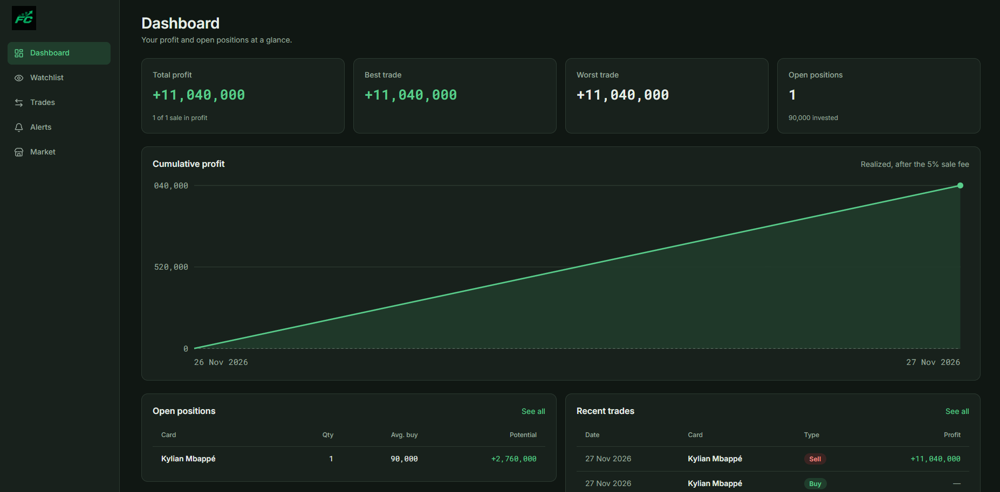
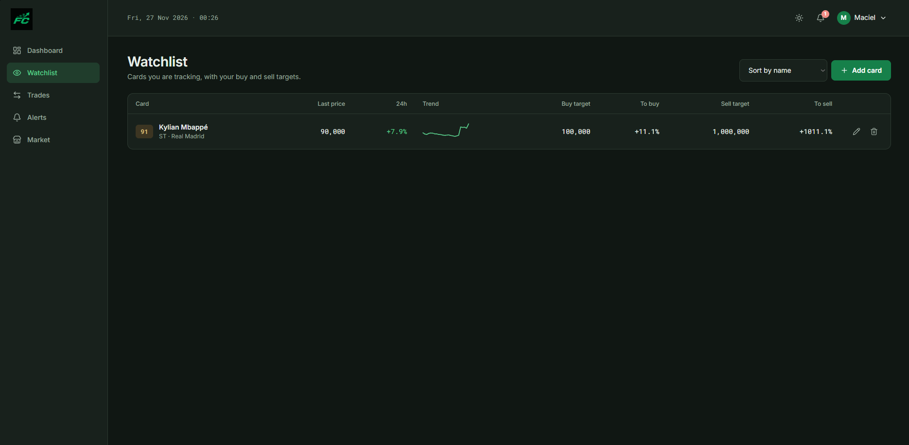
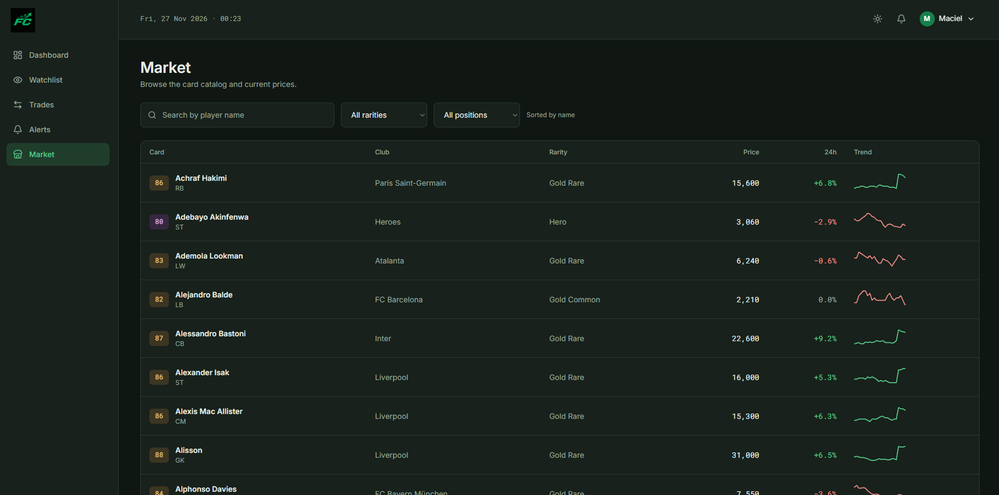

# FC Trade Manager — Frontend

[English](README.md) | **Português (BR)**


[](https://github.com/fc-trade-manager/frontend/actions/workflows/ci.yml)

Cliente em React 19 + TypeScript + Vite para a [API do FC Trade Manager](https://github.com/fc-trade-manager/backend). Ele permite navegar pelo mercado de cartas, manter uma watchlist com metas de compra e venda, registrar seus trades com o lucro calculado **já descontada a taxa de 5% do mercado**, acompanhar seus resultados em um dashboard e ler os alertas que a API cria quando um preço atinge uma meta.

> **Projeto de fã, não oficial.** Não tem afiliação, endosso ou ligação com a Electronic Arts. As cartas e todos os preços são dados fictícios de demonstração.

---

## Índice

- [Funcionalidades](#funcionalidades)
- [Capturas de tela](#capturas-de-tela)
- [Stack](#stack)
- [Como rodar](#como-rodar)
- [Rotas](#rotas)
- [Como conversa com a API](#como-conversa-com-a-api)
- [Notas sobre o modelo de dados](#notas-sobre-o-modelo-de-dados)
- [Estrutura do projeto](#estrutura-do-projeto)
- [Testes e CI](#testes-e-ci)
- [IDs de teste (`data-testid`)](#ids-de-teste-data-testid)
- [Limitações conhecidas](#limitações-conhecidas)
- [Créditos](#créditos)

---

## Funcionalidades

| Página | O que faz |
| --- | --- |
| Market (pública) | Catálogo de cartas com busca por nome, filtros de raridade e posição, paginação, preço atual, variação em 24h e tendência de 30 dias |
| Login / Cadastro | Criação de conta (e-mail, nome de usuário, nome de exibição, senha) e login, com a opção "manter conectado" |
| Dashboard | Lucro total, melhor e pior trade, posições abertas com o valor potencial, trades recentes e um gráfico de lucro acumulado |
| Watchlist | Cartas com metas de compra e venda, último preço, variação em 24h e a distância do preço até cada meta; adicionar, editar metas, remover e ordenar |
| Trades | Registrar, editar e apagar compras e vendas; abas de concluídos, abertos e todos; lucro e retorno por venda |
| Alertas | Feed dos alertas criados pela API, todos ou só os não lidos, marcar um ou todos como lidos; um sino com a contagem de não lidos no cabeçalho |
| Tema | Tema claro e escuro, lembrado no navegador |

## Capturas de tela





## Stack

| Área | Tecnologia |
| --- | --- |
| Interface | React 19, TypeScript, ícones [lucide-react](https://lucide.dev) |
| Build | Vite 8 |
| Rotas | react-router-dom 7 |
| Estado e dados | Hooks do React (`useAsync`, `usePrices`, ...) e `fetch`; sem biblioteca de estado ou de busca de dados |
| Gráficos | Pequenos componentes SVG escritos para o projeto (gráfico de lucro e sparklines), sem biblioteca de gráficos |
| Estilo | CSS puro com design tokens (`src/styles`), fontes Inter e Roboto Mono via Fontsource |
| Testes | Vitest + jsdom + Testing Library |
| Lint | oxlint |

## Como rodar

### Pré-requisitos

- [Node.js](https://nodejs.org) 22 ou mais novo (o CI usa 22)
- O [backend](https://github.com/fc-trade-manager/backend) rodando (por padrão em `http://localhost:5041`)

### Executar

```bash
git clone https://github.com/fc-trade-manager/frontend.git
cd frontend
cp .env.example .env   # Windows (CMD): copy .env.example .env
npm ci
npm run dev
```

O app abre em `http://localhost:5173` (a porta é fixa e já está liberada no CORS do backend em Development).

### Configuração

| Variável | Padrão | Observações |
| --- | --- | --- |
| `VITE_API_URL` | `http://localhost:5041` | URL base da API, sem barra no final. Reinicie o `npm run dev` depois de mudar. Em produção, adicione a origem do front em `Cors:AllowedOrigins` do backend. |

### Scripts

| Comando | O que faz |
| --- | --- |
| `npm run dev` | Servidor de desenvolvimento |
| `npm run build` | Checa os tipos (`tsc -b`) e gera o build em `dist/` |
| `npm run preview` | Serve o build localmente |
| `npm run lint` | oxlint |
| `npm test` | Testes unitários uma vez (`vitest run`) |
| `npm run test:watch` | Testes unitários em modo watch |

## Rotas

| Rota | Acesso | Página |
| --- | --- | --- |
| `/market` | Pública | Market |
| `/login`, `/register` | Só sem sessão | Entrar, criar conta |
| `/` | Com sessão | Dashboard |
| `/watchlist` | Com sessão | Watchlist |
| `/trades` | Com sessão | Trades |
| `/alerts` | Com sessão | Alertas |

Qualquer outro caminho vai para `/`.

## Como conversa com a API

- **Um módulo para HTTP** (`src/lib/api.ts`): toda chamada passa por uma única função `request`, que adiciona o token, lê o JSON e transforma falhas em um `ApiError` com o status e a mensagem da API.
- **Sessão**: depois do login a API devolve um access token (curto) e um refresh token. Com "manter conectado" a sessão fica no `localStorage`; senão, no `sessionStorage`. Sair revoga o refresh token no servidor.
- **Refresh silencioso**: quando uma requisição falha com `401`, o front troca o refresh token por um par novo e repete a requisição uma vez. Várias requisições que falham ao mesmo tempo compartilham **uma única** chamada de refresh (a API rotaciona o refresh token, então dois refreshes em paralelo se invalidariam).
- **Preços exigem login**: `GET /api/cards/{id}/prices` é autenticado no backend, enquanto o catálogo é público. Para um visitante o Market mostra o catálogo e um aviso de que os preços ainda não estão disponíveis.
- **Cache de preços**: o histórico de preços pedido pelo Market e pelo Dashboard fica em memória por pouco tempo, para as tabelas não pedirem de novo a cada renderização.
- **Valores derivados são calculados aqui**: taxa da venda, retorno %, custo médio e valor das posições abertas vêm dos trades e do último preço (veja abaixo), então sempre batem com o que está na tela.

## Notas sobre o modelo de dados

- Vendas têm taxa de 5%; lucro = (preço × 0,95 − preço médio de compra) × quantidade. A taxa, o retorno % e o valor das posições abertas são derivados no cliente a partir dos trades e do último preço.

## Estrutura do projeto

```
src/
├── main.tsx, App.tsx          Ponto de entrada e rotas
├── components/                Layouts (menu, cabeçalho), CardPicker, ProfitChart, UI compartilhada (ui.tsx)
├── pages/                     Market, Auth (login/cadastro), Dashboard, Watchlist, Trades, Alerts
├── lib/
│   ├── api.ts                 Cliente HTTP, fluxo de refresh, endpoints
│   ├── auth.tsx, session.ts   Contexto de autenticação e armazenamento da sessão
│   ├── hooks.ts               useAsync, usePrices, useUnreadAlerts, ...
│   ├── derive.ts, format.ts   Cálculos de lucro/posições e formatação de números/datas
│   ├── theme.tsx              Tema claro e escuro
│   └── types.ts               Tipos das respostas da API (escritos à mão)
└── styles/                    tokens.css, base.css, components.css
```

## Testes e CI

Os testes unitários com Vitest cobrem a lógica que não precisa de navegador: lucro, posições e estatísticas de preço (`derive.test.ts`), formatação de números e datas (`format.test.ts`), armazenamento da sessão (`session.test.ts`) e o componente de paginação (`Pagination.test.tsx`).

```bash
npm test
```

O GitHub Actions (`.github/workflows/ci.yml`) roda em pushes e pull requests para a `main`: **lint** (oxlint), **typecheck** (tsc) e **testes unitários** em paralelo e, depois, o **build** (Vite), que publica o `dist` como artefato.

Os testes ponta a ponta (Playwright) ficarão em um repositório separado e dependem dos atributos `data-testid` abaixo.

## IDs de teste (`data-testid`)

Atributos estáveis para testes E2E (Playwright). Não aparecem para o usuário e não dependem de texto, classe CSS nem posição.

### Convenção

- Nomes em `kebab-case`, no formato `area-elemento` (`login-submit`, `watchlist-row`).
- Listas usam o mesmo `data-testid` em todas as linhas (`trade-row`) e identificam a linha por atributos `data-*` (`data-card-name`, `data-trade-type`), em vez de colocar ids dinâmicos no nome.
- Prefira `getByRole` quando o elemento tem papel e nome claros; use `getByTestId` para o resto.
- Ao renomear ou remover um id, atualize os Page Objects dos testes no mesmo PR.

### Exemplos (Playwright)

```ts
// formulário de login
await page.getByTestId('login-email').fill(email)
await page.getByTestId('login-password').fill(password)
await page.getByTestId('login-submit').click()

// linha específica da watchlist
const row = page.locator('[data-testid="watchlist-row"][data-card-name="Kylian Mbappé"]')
await expect(row.getByTestId('watchlist-last-price')).toHaveText('54,000')

// linha de venda de uma carta
const sale = page.locator('[data-testid="trade-row"][data-card-name="Pelé"][data-trade-type="sell"]')

// o confirm() nativo da remoção precisa ser aceito
page.once('dialog', (d) => d.accept())
await row.getByTestId('watchlist-remove').click()
```

### Lista

#### Componentes compartilhados (`src/components/ui.tsx`)

- `side-badge`
- `loading`
- `error-state`
- `error-retry`
- `empty-state`
- `field-error`
- `form-error`
- `modal`
- `modal-close`
- `pagination`
- `pagination-prev`
- `pagination-info`
- `pagination-next`

#### Layout (menu, cabeçalho, conta) (`src/components/Layouts.tsx`)

- `theme-toggle`
- `account-menu-button`
- `account-name`
- `account-menu`
- `logout-button`
- `nav-${label.toLowerCase()}`
- `alerts-bell`
- `alerts-unread-badge`
- `public-signin-link`
- `public-register-link`

#### Seletor de carta (`src/components/CardPicker.tsx`)

- `card-picker-selected`
- `card-picker-clear`
- `card-picker-input`
- `card-picker-list`
- `card-picker-error`
- `card-picker-empty`
- `card-picker-option`

#### Login e cadastro (`src/pages/Auth.tsx`)

- `auth-market-link`
- `login-form`
- `login-email`
- `login-password`
- `login-remember`
- `login-submit`
- `register-form`
- `register-display-name`
- `register-username`
- `register-email`
- `register-password`
- `register-submit`

#### Market (`src/pages/Market.tsx`)

- `market-search`
- `market-rarity`
- `market-position`
- `market-notice`
- `market-table`
- `market-row`
- `market-price`
- `market-change`

#### Watchlist (`src/pages/Watchlist.tsx`)

- `targets-form`
- `targets-buy-input`
- `targets-sell-input`
- `targets-cancel`
- `targets-submit`
- `watchlist-sort`
- `watchlist-add-button`
- `watchlist-table`
- `watchlist-row`
- `watchlist-last-price`
- `watchlist-change-24h`
- `watchlist-buy-target`
- `watchlist-to-buy`
- `watchlist-sell-target`
- `watchlist-to-sell`
- `watchlist-edit`
- `watchlist-remove`

#### Trades (`src/pages/Trades.tsx`)

- `trade-form`
- `trade-side-buy`
- `trade-side-sell`
- `trade-price-input`
- `trade-quantity-input`
- `trade-total`
- `trade-cancel`
- `trade-submit`
- `trade-edit`
- `trade-delete`
- `trades-new-button`
- `trades-tab-${id}`
- `trade-row`
- `trade-profit`
- `trade-return`
- `position-row`
- `position-qty`
- `position-avg-buy`
- `position-potential`

#### Alerts (`src/pages/Alerts.tsx`)

- `alerts-mark-all-read`
- `alerts-tab-all`
- `alerts-tab-unread`
- `alerts-feed`
- `alert-item`
- `alert-title`
- `alert-price`
- `alert-mark-read`

#### Dashboard (`src/pages/Dashboard.tsx`)

- `metric-total-profit`
- `metric-best-trade`
- `metric-worst-trade`
- `metric-open-positions`
- `profit-chart`
- `dashboard-open-positions`
- `dashboard-position-row`
- `dashboard-position-potential`
- `dashboard-recent-trades`
- `dashboard-trade-row`
- `dashboard-trade-profit`

### Atributos `data-*` das linhas

| Linha | Atributos |
| --- | --- |
| `watchlist-row` | `data-card-id`, `data-card-name` |
| `market-row` | `data-card-id`, `data-card-name` |
| `trade-row` | `data-trade-id`, `data-card-name`, `data-trade-type` (`buy` ou `sell`) |
| `position-row`, `dashboard-position-row` | `data-card-name` |
| `dashboard-trade-row` | `data-card-name`, `data-trade-type` |
| `alert-item` | `data-alert-kind` (`buy` ou `sell`), `data-card-name`, `data-read` (`true` ou `false`) |
| `card-picker-option` | `data-card-name` |
| `side-badge` | `data-side` |

## Limitações conhecidas

- Ainda não existe página de detalhe da carta; o Market mostra uma tendência de 30 dias ao lado de cada carta, em vez de um gráfico completo.
- Os tipos da API em `src/lib/types.ts` são escritos à mão, não gerados a partir do documento OpenAPI.
- Os preços só aparecem depois do login (veja [Como conversa com a API](#como-conversa-com-a-api)).
- Datas e números usam um formato fixo, e a interface está só em inglês.

## Créditos

Autor: [Mysterion147](https://github.com/Mysterion147) · Licença: [MIT](LICENSE)

A base para esta documentação foi gerada por [Claude](https://claude.ai) (Anthropic) a partir do repositório da solução e dos requisitos do projeto, e foi revisada manualmente pelo autor.

Parte do projeto [FC Trade Manager](https://github.com/fc-trade-manager), com o [backend](https://github.com/fc-trade-manager/backend), o [script de preços](https://github.com/fc-trade-manager/price-seed-script) e a [documentação](https://github.com/fc-trade-manager/docs).
